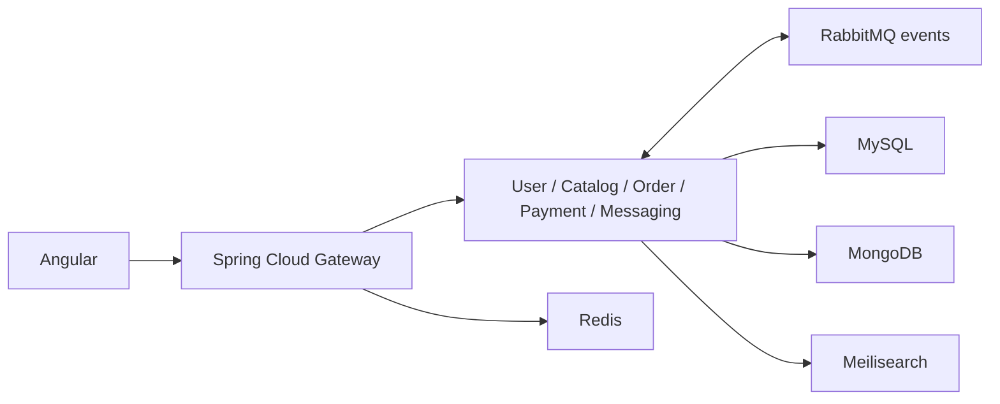

# Rebyte

A second-hand marketplace for hardware and software, built with Angular and
Spring Boot microservices. Physical products follow a shipping workflow; software
listings support versions, licenses and digital delivery.

## What it does

- Browse hardware and software listings with category-specific attributes,
  faceted search and favourites.
- Publish listings, manage software versions and negotiate offers.
- Follow checkout, payment, delivery, license and review workflows.
- Exchange messages over WebSocket and receive email notifications.
- Sign in through Amazon Cognito, with separate buyer, seller, developer and
  administrator capabilities.

**Demo status:** public source is available; image publication and deployed demo
acceptance are in progress. Payments use the PayPal sandbox. Live checkout,
reset and deployment checks are still pending.

## Architecture



Each service owns its data. Synchronous cross-service reads use OpenFeign on
internal endpoints; asynchronous integration uses RabbitMQ events. Services
discover each other through Eureka. The gateway handles public routing, JWT
validation, rate limiting and the WebSocket entry point; internal endpoints
remain private.

| Module | Responsibility | Primary storage |
| --- | --- | --- |
| `user-service` | Profiles, avatars, follows and roles | MySQL |
| `catalog-service` | Listings, category attributes, favourites, software versions and search | MongoDB, Meilisearch |
| `order-service` | Checkout, offers, shipping, licenses and reviews | MySQL |
| `payment-service` | PayPal sandbox orders, verified webhooks and refunds | MySQL |
| `messaging-service` | Conversations, STOMP messaging, notifications and SES email | MongoDB |
| `api-gateway` | Public API, authentication boundary, rate limiting and WebSocket proxy | Redis for rate limiting |
| `discovery-server` | Eureka service registry | None |
| `it.rebyte.commons` | Shared contracts, security, media, errors and events | None |
| `web` | Angular marketplace frontend | Backend APIs |

See the [architecture](docs/architecture.md) for service boundaries, persistence
choices and the checkout saga. The [domain model](docs/rebyte_progettazione.md)
is the binding reference when the documents differ.

## Stack

| Area | Technology |
| --- | --- |
| Backend | Java 26, Spring Boot 4.1.1, Spring Cloud 2025.1.3 |
| Frontend | Angular 22.2, TypeScript 6, NgRx Signals |
| Build | Maven wrapper, Node.js 24.21.0, npm 12.2.0 |
| Data | MySQL 8.4, MongoDB 7, Redis, Meilisearch |
| Integration | RabbitMQ, OpenFeign, WebSocket/STOMP |
| External services | Amazon Cognito, S3, CloudFront, SES/SQS, PayPal sandbox |
| Verification | Testcontainers, frontend unit tests, Playwright |

## Run locally

You need Docker with Compose, JDK 26, Node.js 24.21.0 and npm 12.2.0. Maven is
downloaded by the included wrapper.

### Configure your environment

From the repository root:

```bash
cp infra/.env.example infra/.env
```

Set local passwords and the required integration values in `infra/.env` before
starting the backend. The template documents the variables; Compose refuses
missing required values. Features using Cognito, AWS media/email or PayPal need
your own service configuration and credentials.

The frontend loads API, WebSocket and Cognito settings from
[`web/public/config.json`](web/public/config.json). Update it for your environment.
It is served to browsers and must contain only public configuration.

### Start the backend

```bash
docker compose -f infra/docker-compose.yml -f infra/docker-compose.services.yml up -d --build --wait
```

The API gateway is available at `http://localhost:8080`; Eureka is at
`http://localhost:8761`. The Compose files also start the application datastores
and initialize MongoDB as a replica set for transactions.

If you only need the local datastores, use this command instead:

```bash
docker compose -f infra/docker-compose.yml up -d --build
```

MongoDB uses host port `27017`, matching its replica-set address. That port must
be available. Other local datastore and service ports are configurable in the
environment template.

### Start the frontend

```bash
npm --prefix web ci
npm --prefix web start
```

Open `http://localhost:4200`. The development frontend uses the runtime
configuration above to reach the backend.

## Build and test

Run these commands from the repository root with Docker running for backend
integration tests:

```bash
./mvnw -B verify
npm --prefix web run test:ci
npm --prefix web run build
```

On Windows, use `.\mvnw.cmd -B verify` for the Maven command.
Browser journeys use [Playwright](web/playwright.config.ts), including Cognito
test-user setup. Run them only against a configured development environment.

## Demo deployment

The [release workflow](.github/workflows/demo-images.yml) verifies the backend,
frontend and demo tooling, then builds a coordinated set of container images.
The [demo Compose file](infra/docker-compose.demo.yml) consumes those images;
deployment through Coolify is manual.

This public repository is a reviewed source snapshot. `demo-source.json` records
its development-source revision; GitHub commits identify the distinct public
releases. Credentials, deployment-specific AWS/Atlas configuration, Postman
collections and optional operator tools stay in the private development repository.
The scripts required to build, test and run the published images are included.

## Documentation

- [Domain model](docs/rebyte_progettazione.md): concepts, rules and data model.
- [Architecture](docs/architecture.md): service design and integration patterns.
- [Testing conventions](docs/testing-conventions.md): unit, integration and browser testing.
