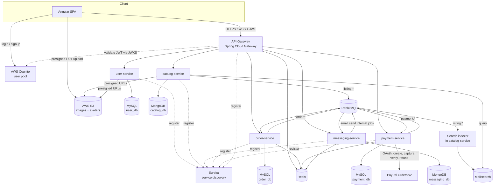
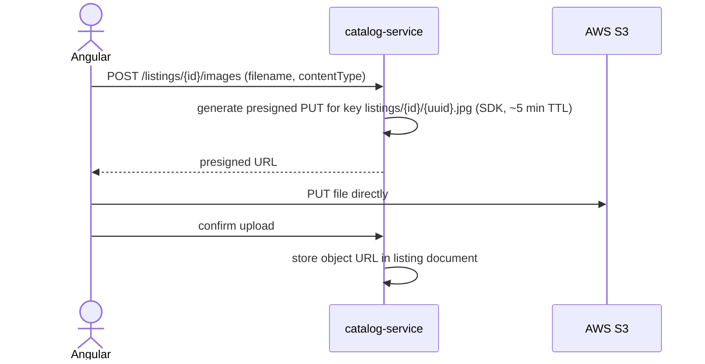
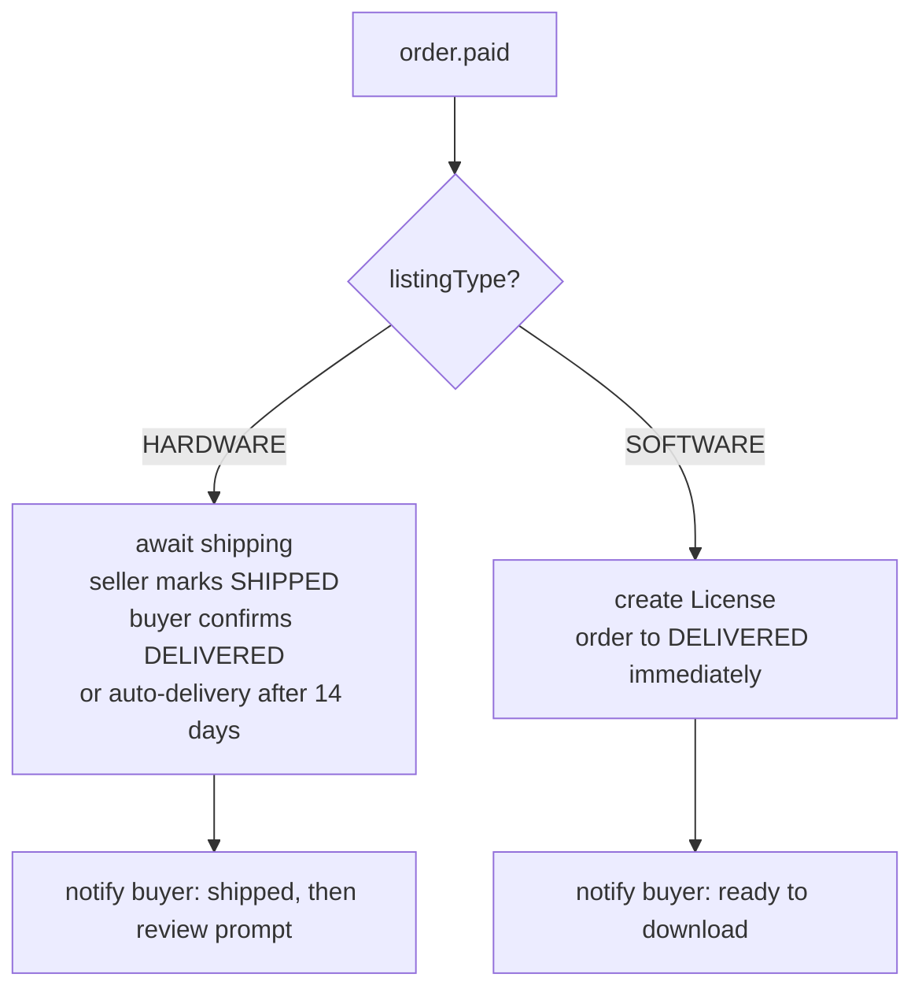
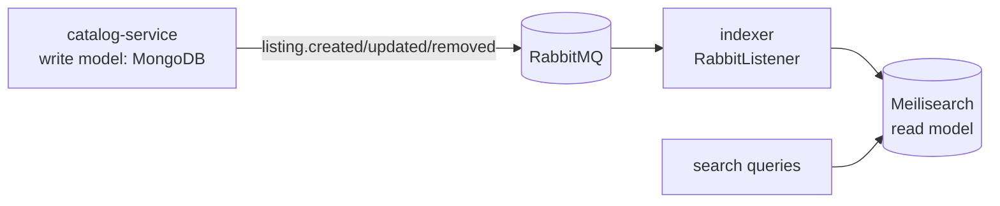
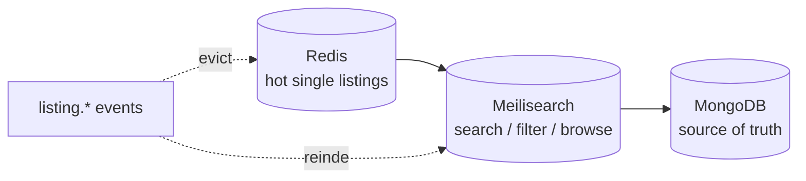

# Marketplace App — Architecture & Design (Microservices)

A second-hand marketplace for **hardware** (physical, shipped) and **software** (digital): browse, create, favorite, and buy listings; search; message and follow sellers; leave reviews; get notified; manage a profile. Backend is Spring Boot microservices; frontend is Angular. The backend and Angular frontend run on the same Contabo VPS 6, managed by Coolify. Identity (AWS Cognito) and media (AWS S3) remain managed cloud services. Checkout uses PayPal Orders v2 sandbox and search uses Meilisearch.

---

## 1. Scope & guiding decisions

- **Microservices, kept deliberately small.** Five business services + a gateway + service discovery. Enough to demonstrate real microservice architecture (independent deployables, per-service databases, inter-service messaging) without becoming unrunnable on modest hardware.
- **Polyglot persistence, database-per-service.** MySQL for `user`, `order`, `payment` — money and identity need relational integrity and ACID. MongoDB for `catalog` and `messaging` — listings carry category-specific attributes and embedded images; messages are append-mostly threads. Both are document-shaped, neither is relational. Each service owns its own schema/database and no service reads another's.
- **Event-driven where it counts.** RabbitMQ carries verified payment results, order lifecycle events, notification fan-out and the search-index projection. Synchronous cross-service reads use OpenFeign.
- **Payments use real PayPal Orders v2 sandbox calls.** Search uses Meilisearch. Identity uses Cognito in deployment and the local-auth issuer for development (§2c).
- **Managed services at the edges, owned compute in the middle.** The box runs only what demonstrates architecture (services, databases, broker, cache, search). Identity is delegated to AWS Cognito, media to AWS S3 — pay-per-use services that cost ~€0 at exam scale and never bill while idle. AWS API Gateway was considered and rejected (see §2c).
- **Follow/unfollow is retained** in the backend (user-service) although the current prototype has no UI for it; the UI is planned. Checkout also gains a shipping step for physical goods.
- **The conceptual model in `rebyte_progettazione.md` is binding.** Where this document and the UML analysis disagreed, the UML won: `License` (not `Entitlement`), the six-value `OrderStatus` enum including `refunded`, software `Version` as a first-class part of a software listing, and reservation of a hardware listing at order creation rather than at payment. Admin, moderation and the developer-profile role — all present in the model and absent from the first draft of this document — are specified here too (§7c).
- **Resource budget ~3.2 GB.** Every Spring service is capped by a compose `mem_limit` plus `-XX:MaxRAMPercentage`, never a bare `-Xmx`, and runs with `-XX:+UseSerialGC -Xss512k -XX:ReservedCodeCacheSize=64m`; business services get `mem_limit: 400m` with `-XX:MaxRAMPercentage=35` (§11). With MongoDB on the Atlas free tier, the measured projection is about 2.86 GB on the host. This historical projection excludes Coolify and its proxy; the Contabo host budget must include those components, build peaks (§11).

---

## 2. Architecture at a glance



### Services and what they own

| Service | Owns (schema) | Responsibilities | Publishes |
|---|---|---|---|
| **api-gateway** | — | Single entry point, routing, JWT validation, rate limiting (Redis) | — |
| **discovery-server** | — | Eureka registry | — |
| **user-service** | MySQL `user_db` | Profiles (avatar, bio, presigned avatar uploads), follow graph, **developer profiles**, **admins**, and the denormalized **seller rating aggregate**. Identity is delegated to Cognito; rows are keyed by the Cognito `sub` claim | `user.followed`, `user.unfollowed`, `user.updated`, `user.developer_activated` |
| **catalog-service** | Mongo `catalog_db` | Listings (with their hardware/software part, embedded `versions[]` and `priceHistory[]`), the category tree, images, favorites, moderation records; owns the Meilisearch projection | `listing.created/updated/removed`, `listing.favourited`, `listing.unfavourited`, `listing.version.released` |
| **messaging-service** | Mongo `messaging_db` | Conversations and immutable messages over REST; STOMP pushes, presence and typing; notifications, private chat images and SES email delivery | No business events; `email.send` is an internal job |
| **order-service** | MySQL `order_db` | Order lifecycle, checkout saga orchestration, **software licences**, **reviews** | `order.created`, `order.paid`, `order.shipped`, `order.delivered`, `order.cancelled`, `order.refunded`, `order.problem.opened`, `order.problem.resolved`, `licence.issued`, `licence.revoked`, `review.created` |
| **payment-service** | MySQL `payment_db` | PayPal orders, capture claims, signed webhooks, reconciliation, full refunds | `payment.succeeded`, `payment.failed`, `payment.refunded` |

> **Note on service count:** favorites + the follow graph live inside catalog/user rather than as their own services, and the search indexer is a component *inside* catalog-service (a `@RabbitListener` that projects into Meilisearch) rather than a separate deployable. Both choices keep the container count sane while preserving clean logical boundaries — you can extract either later without touching callers.

> **Note on `Review`.** The conceptual model identifies `Review` externally by its `Order`, and `[V.Review.legalReview]` requires reading the order's status and instant to decide whether a review is legal at all. Only order-service can check that in one transaction, so it owns the write model. Reputation is still a property of the *user*, so user-service keeps `ratingAvg` / `ratingCount` as a denormalized projection fed by `review.created` — see §7b.

---

## 2b. Persistence: why polyglot

| Service | Store | Why |
|---|---|---|
| user, order, payment | **MySQL 8** | Money and identity. Foreign keys, ACID transactions, strong consistency. The saga's outbox rows commit atomically with state changes. |
| catalog, messaging | **MongoDB 7** | Document-shaped by nature. |

**Why listings are a document.** A car listing has mileage, year, fuel type; a phone has storage, battery health; an apartment has m² and energy class. In a relational table that's either dozens of mostly-null columns, an EAV attribute table (join-heavy, ugly), or a JSON column. In Mongo each listing simply carries the attributes its category needs, and `images[]` embeds instead of requiring a `listing_images` join. **The document is the shape of the listing-detail page — one read, no joins.**

**Why messages are documents.** High-write, append-mostly, thread-shaped, no relational requirements. Mongo is the natural fit and costs no extra container.

### ⚠️ MongoDB must run as a replica set

The catalog and messaging outboxes write the domain change *and* its event in one transaction. **MongoDB only supports multi-document transactions in replica-set mode.** A plain standalone `mongo` container has no transactions at all — your outbox would silently be non-atomic.

A **single-node** replica set is enough. The compose file starts mongod with `--replSet rs0` and its healthcheck performs the one-time `rs.initiate()`. Service URIs must include `?replicaSet=rs0`. This is the single most common way to get this design subtly wrong.

### Deployment: MongoDB Atlas free tier

In deployment, `catalog_db` and `messaging_db` run on the **MongoDB Atlas** free tier; local development keeps the Mongo container from `infra/docker-compose.yml`, which is where the replica-set setup above applies. Atlas clusters are replica sets, which is what the outbox transactions require, so there is no `--replSet` and no `rs.initiate()` to manage. MongoDB also takes no RAM on the host (§11); the local container measured 299.7 MiB in [02-MEMORY.md](../.planning/phases/02-catalog-category-attributes-and-search/02-MEMORY.md). The GitHub Student Pack includes Atlas credits. Atlas free-tier limits (storage cap, transaction support for the outbox, connection limits) are **not yet verified** and must be checked before the Phase 7 deployment.

The deployed instance sets `SPRING_MONGODB_URI`, which binds the Spring Boot 4.1 property `spring.mongodb.uri`, to the Atlas connection string in `.env`. Local catalog-service uses the same property with a single-node replica-set URI. Trade-off: network latency instead of localhost.

**Simplest alternative (one fewer engine):** keep listings in MySQL and put category-specific attributes in a native `JSON` column with functional indexes. Most of the schema flexibility, full ACID for the outbox, no new infrastructure — at the cost of the polyglot story.

---

## 2c. Cloud service map

Every external service, what it does, and what it costs:

| Service | Role | Cost |
|---|---|---|
| **Contabo VPS 6** | Application host: Angular frontend, services, gateway, Eureka, MySQL, Redis, RabbitMQ and Meilisearch; MongoDB remains on Atlas (§2b) | Verify the ordered plan, resources and billing during deployment planning |
| **Coolify** | Manages frontend and backend deployment, environment values, persistent storage and HTTPS proxy on the same VPS | Include platform and proxy usage in the host budget |
| **Namecheap / Name.com** (GitHub Student Pack) | Domain — free `.me` for a year (Namecheap) or a free domain on `.live` / `.app` / `.dev` etc. (Name.com) | €0 first year |
| **Cloudflare** | Free DNS for the domain; Tunnel for exposing the dev machine | €0 |
| **AWS Cognito** | Identity: signup, login, email verification, password reset, JWT issuing | €0 — 10,000 MAU free tier, does not expire |
| **AWS S3** | Listing images + avatars via presigned direct uploads | ~€0 at exam scale (cents/month) |
| **MongoDB Atlas** *(deployment, §2b)* | Hosts `catalog_db` and `messaging_db` in deployment; local development keeps the Mongo container | €0: free tier or Student Pack credits; free-tier limits not yet verified |
| **PayPal** (§3) | Orders v2 sandbox for create, capture, signed webhooks and full refunds | Sandbox credentials supplied outside Git |

### Identity: Cognito

A **Cognito User Pool** owns the account lifecycle. Angular authenticates against it directly (Amplify Auth / `amazon-cognito-identity-js`) and receives standard JWTs. The gateway validates them as an **OAuth2 resource server** — configuration, not code:

```yaml
spring:
  security:
    oauth2:
      resourceserver:
        jwt:
          issuer-uri: https://cognito-idp.${AWS_REGION}.amazonaws.com/${COGNITO_USER_POOL_ID}
```

Spring Security fetches Cognito's public keys (JWKS) and validates signatures automatically. Downstream services receive identity claims as headers from the gateway. user-service stores profile/domain data keyed by the token's `sub` claim — it is a profile service, not an identity provider.

#### Why identity has no second implementation

Payments and search sit behind ports because both have a cheap fake that is *structurally* the same as the real thing — an async webhook, a text index. Identity does not. Token **validation** is genuinely one line of configuration, but token **issuance** is not a swap at all: a fallback would mean a second registration flow, a second login endpoint, a keypair and a JWKS endpoint to maintain, and a confirmation step that exists under Cognito and not under the fallback. That is a parallel subsystem wearing an interface, and the interface would be hiding a difference rather than absorbing one.

So Angular talks to the user pool directly and there is no `IdentityProvider` port. The practical consequences are worth stating plainly rather than discovering during a demo:

- **Cognito must be reachable to log in.** There is no offline mode. Have a signed-in browser session or a captured token on hand for a live demo, and record a fallback video.
- **Registration is two-step.** Cognito emails a confirmation code and the account is unusable until confirmed, so the frontend needs a confirm screen. A Pre-Signup Lambda can auto-confirm instead, which removes the screen at the cost of email verification — a defensible trade for a course project, but state it rather than leaving it implicit.
- **`authenticate(email, password)` is a system operation in §9 of the model.** Under this design it is discharged by a component of the system that happens to be managed rather than self-written. That is the honest reading, and it is the answer to give if asked; it is also the one point where a self-implemented flow would have scored more directly.

#### How Cognito lands on the conceptual model

The restructured schema in `rebyte_progettazione.md` is deployment-independent (its §13 says so), so "the system authenticates users" is a statement about the system, and Cognito is a decision about *which component discharges it*. Four consequences worth being able to state:

| Model element | Under Cognito |
|---|---|
| `User.id` `{id}` | Is the Cognito `sub` claim. Still a UUID, still surrogate, still immutable — §10.6's argument for a surrogate identifier is unchanged, the value simply arrives from the IdP instead of `UUID.randomUUID()`. |
| `User.email {unique}` | Enforced by the user pool's email alias, not by `user_db`. `update_credentials` writes Cognito first (it owns address verification), then syncs the profile row on success. |
| `User.password` | Not stored in `user_db` at all — there is no password column, and no service ever sees the plaintext. The attribute is conceptual; Cognito holds the credential and the browser sends it there directly. |
| `Admin` | A Cognito user in an `ADMIN` group. user-service keeps an `Admin` row keyed by `sub`, with `preferred_username` carrying the model's `{id}`. `Admin` is still not a subclass of `User`, exactly as the model has it. |

### Media: S3 presigned uploads

Image bytes never pass through the backend — the €0 box never carries upload bandwidth:



Same flow in user-service for avatars. Serve images from a public-read prefix, or put **CloudFront** in front (1 TB/month free transfer) as optional polish. Credentials: one IAM user scoped to `s3:PutObject/GetObject/DeleteObject` on `arn:aws:s3:::<bucket>/*` only — never the root account, keys only in `.env`.

### AWS account setup — one trap

New AWS accounts choose a **Free plan** or **Paid plan**. The Free plan auto-closes after 6 months or when credits run out — taking the Cognito user pool and S3 bucket with it. **Choose the Paid plan**: the always-free tiers (including Cognito's 10k MAU) still apply, and Cognito + light S3 usage bills ~€0. Set a $1 budget alert on day one; never create a NAT Gateway.

### Considered and rejected: AWS API Gateway

It cannot privately reach services on a non-AWS box (VPC Link requires an AWS VPC), it knows nothing about Eureka — replacing the component that demonstrates service discovery with a static-route proxy — and its WebSocket model doesn't fit STOMP-over-WS. Cognito and S3 work because they are *leaf* services the app calls out to; a gateway must sit where the services are. Spring Cloud Gateway stays.

---

## 3. The checkout saga (order + payment)

Phase 3 uses PayPal Orders v2 in sandbox. `order-service` owns the buyer-visible
order and the right to authorize capture; `payment-service` owns provider calls,
signed webhook verification, payment state and refunds. Each service writes only
its own database. Feign calls on `/internal/**` carry synchronous commands and
reads; RabbitMQ carries state events from transactional outboxes.

### Order lifecycle and capture fence

```text
AWAITING_PAYMENT -> PAID -> SHIPPED -> DELIVERED   (hardware, Phase 4 fulfilment)
                 -> CANCELLED                       (before capture or with terminal no-charge proof)
PAID | SHIPPED | DELIVERED -> REFUNDED              (signed refund webhook)
```

Software remains `PAID` until Phase 4 grants a `License` and advances it to
`DELIVERED`. The operational checkout phase is stored separately from
`OrderStatus` as `CREATING`, `READY`, `CAPTURE_AUTHORIZED` or `CANCELLED`.
`payment-service` must obtain an order-owned `READY -> CAPTURE_AUTHORIZED`
claim before sending a capture request. A buyer cancellation or failed create
can atomically change only `CREATING` or `READY` to `CANCELLED`; a granted
capture wins the race and retains the listing guard. No MySQL transaction spans
a Feign or PayPal request.

The exact cancellation reasons are `PAYMENT_DECLINED`, `TIMEOUT`,
`BUYER_ABORTED`, `PAYMENT_UNAVAILABLE` and `LISTING_UNAVAILABLE`. A failed
payment create, including an unreachable payment-service, cancels and records
`order.cancelled` in the original `POST /orders` request. A late provider
response cannot move a cancelled order back to `READY`; its subsequent capture
claim is denied. Expired `CREATING` rows are recovered by an order-service
sweep.

### Hardware reservation and price

Before creating an order, `order-service` reads the current listing price and
availability from catalog-service through Feign. A nullable unique
`active_listing_guard` column in `order_db` permits one live hardware order per
listing, even when two buyers race. Software orders have no guard and may be
purchased repeatedly. Redis is not a checkout correctness lock.

The winning hardware order sends `PATCH /internal/listings/{id}/reserve` with
its own `orderId` as the caller-supplied `reservationId`. Catalog makes reserve
idempotent on that ID. An order cancellation or refund clears the MySQL guard
and records an outbox event in the same transaction; catalog releases only a
matching reservation and fences that ID against a delayed reserve. A stale
release cannot undo a later buyer's reservation.

### PayPal create, capture and webhook

```mermaid
sequenceDiagram
  actor B as Buyer
  participant O as order-service
  participant C as catalog-service
  participant P as payment-service
  participant PP as PayPal
  participant MQ as RabbitMQ

  B->>O: POST /orders (Idempotency-Key)
  O->>C: fresh listing read; reserve hardware by orderId
  O->>O: commit order, guard and outbox
  O->>P: POST /internal/payments
  P->>PP: Orders v2 create
  P-->>O: provider order and approvalUrl
  O-->>B: orderId and approvalUrl
  B->>PP: approve in browser
  B->>P: POST /payments/{orderId}/capture
  P->>O: claim capture authorization
  P->>PP: Orders v2 capture
  P-->>B: accepted, awaiting confirmation
  PP->>P: signed PAYMENT.CAPTURE.COMPLETED
  P->>P: verify raw body and signature; commit payment and outbox
  P-)MQ: payment.succeeded
  MQ-)O: guarded PAID transition and outbox
```

A successful capture HTTP response never marks the order `PAID`. Only the
verified PayPal webhook may emit `payment.succeeded`; the same rule applies to
`payment.refunded` and `REFUNDED`. The webhook route accepts anonymous POST
and preserves raw bytes and PayPal headers; all other payment routes require
JWT. The payment service verifies PayPal's signature before deserializing or
changing state. Durable local operation IDs and event IDs make duplicate
capture requests and webhook deliveries idempotent without assuming a long
provider replay window.

The reconciliation sweep queries PayPal for uncertain captures and expires
unpaid orders only with terminal no-charge evidence. It flags captures awaiting
a missing webhook for admin diagnostics. An admin full refund requires a reason
and returns `REFUND_PENDING`; `REFUNDED` waits for the signed refund webhook.
Money lands in Rebyte's sandbox business account. Seller payouts are outside
Phase 3. `creditCard` uses PayPal guest checkout. `bankTransfer` remains in the
conceptual model but Phase 3 rejects it with 422; it cannot bypass webhook-only
payment confirmation.

A concrete `PayPalClient` implements the provider HTTP calls. There is no
mock provider profile, manual transfer adapter or `PaymentGateway` port in this
phase: the code has one provider implementation.

### Consistency and recovery

The order and payment services each write state plus an outbox event atomically.
Relays publish to RabbitMQ; inbox/event IDs absorb redelivery. Catalog consumes
`order.cancelled` and `order.refunded` for a matching hardware release. Failed
delivery is parked in a queue-specific DLQ, with depth metrics and an admin
one-message replay after repair. Admin stuck-order diagnostics combine local
order state with payment-service's internal status DTO, without reading
`payment_db` from order-service.

---

## 3b. Fulfillment fork: hardware vs software

Listings carry a `listingType` of `HARDWARE` (physical, shipped) or `SOFTWARE` (digital). The saga is identical up to `PAID`; Phase 4 adds the differing fulfilment paths below.



**Checkout differences**

| | HARDWARE | SOFTWARE |
|---|---|---|
| Reserved | at order creation (`status = sold`) | never — unlimited sales |
| Shipping address | required on the order | absent |
| Shipping cost | added to total | none |
| On payment | `PAID`, awaits shipment; refunded automatically if not shipped within 7 days | `DELIVERED` at once, with a licence issued in the same transaction |
| Delivery | seller records tracked shipping; buyer confirms receipt or automatic fallback | presigned S3 GET, licence-gated |

**License** (in `order_db`, owned by order-service):

```
License { key {unique}, orderId, buyer, listing, status (ACTIVE | REVOKED), issuedAt, revokedAt }
```

Keyed by `key`, with the order as its second identifier — the conceptual model's `License`, not the `Entitlement` of this document's first draft. In particular there is **no** unique index on `(buyerId, listingId)`: §10.6 of the model uses "the same buyer can purchase the same software listing twice" as part of its justification for a surrogate `Order.id`, so forbidding it here would contradict the reasoning that motivates an identifier decision elsewhere. Two purchases yield two keys, which is also how software licensing actually works.

Download authorization is therefore "the caller holds *some* `ACTIVE` licence on this listing," not "the caller holds *the* entitlement."

**Hardware fulfilment.** Only the listing's seller moves a hardware order `PAID -> SHIPPED` with `POST /orders/{id}/ship` (a `carrier` and a `trackingCode`, immutable afterwards). Only the buyer confirms receipt with `POST /orders/{id}/deliver`, moving `SHIPPED -> DELIVERED`. This is the interim manual flow until carrier integration is implemented. Two order-service sweeps complete the cycle: a `SHIPPED` order is delivered automatically 14 days after `shippedAt` unless an open problem report or a requested refund pauses it, and a hardware order still `PAID` 7 days after `paidAt` is refunded automatically through the admin refund path with reason `NOT_SHIPPED`. A `refundRequestedAt` marker on the order, committed before the payment-service call, blocks shipping and delivery while a refund may still land. `order.refunded` carries `refundedFromStatus`, and a `reservationId` only for a refund from `PAID`, so catalog relists the item only when it never left the seller.

**Licence issuance and revocation.** The `payment.succeeded` consumer moves a software order to `DELIVERED` and creates the licence in one transaction, writing `order.paid`, `order.delivered` and `licence.issued` to the outbox. The key follows the developer-defined `licenceKeyPattern` of the `SoftwareListing`, snapshotted onto the order at checkout; the default is `RBYT-#####-#####-#####-#####`. A refund of a software order sets the licence to `REVOKED` with `revokedAt`, keeps the row and publishes `licence.revoked`. Buyers list their keys with `GET /licences/me`.

### Software versions

A `SoftwareListing` carries `versions[]` embedded in its catalog document — `number`, `releasedAt`, `notes`, `artifactKey` — at least one, created together with the listing itself. Because versions hang directly off the listing, no `Product` entity is needed and no new collection appears.

The seller publishes a new one with `POST /listings/{id}/versions`. catalog-service validates that the number is unused within the listing and strictly greater than the current one, then appends and emits `listing.version.released`.

A licence grants access to **every** version of its listing, including versions released after purchase. `includedVersions()` is derived, so nothing is written when a version appears and there is no licence↔version mapping to backfill — a holder's entitlement widens by itself. That is the cheapest possible reading of the model's *"la licenza include anche le versioni rilasciate dopo l'acquisto"*.

**Two traps.**

`[V.Version.uniqueOrderedNumber]` forbids a higher version number from carrying an earlier release instant. Since versions are append-only and stamped with `now`, this holds for free — *provided the seller never supplies `releasedAt`*. Keep it out of the request DTO.

Version comparison must be **semantic, not lexicographic**. `"2.10.0" < "2.9.0"` under string ordering, and that is precisely the case `release_version`'s precondition exists to catch.

**Fan-out.** `listing.version.released` is consumed by messaging-service, which assembles the recipient set from two services: licence holders (`GET /internal/licences/holders?listingId=` on order-service) and followers of the seller (`GET /internal/followers?userId=` on user-service). The union receives one `RELEASE` notification each, targeted at the version. Duplicates are dropped — someone who follows the seller *and* owns a licence is notified once.

**Delivery flow.** The seller uploads each version's file via a presigned PUT (`POST /listings/{id}/versions/{number}/artifact-upload-policy`, prefix `software/` plus the listing and version), with a separate 100 MiB cap for artifacts, and the bucket keeps Block Public Access on. An owner-only, set-once `POST /listings/{id}/versions/{number}/artifact/confirm` checks the uploaded object and stores `artifactKey` on the version; public views expose only `artifactAvailable`. `GET /listings/{id}/versions/{number}/download` in catalog-service then authorizes the caller through order-service `GET /internal/licences?buyerSub=&listingId=` and returns a **short-TTL presigned GET URL** (120 seconds by default). The listing's seller and admins download without a licence; if order-service cannot answer, the request fails with 503 and no URL is issued. A holder of an `ACTIVE` licence keeps access after the seller removes the listing, and loses it when an admin moderation removal exists. The file is never public; the licence is the only key. Buyers reach their purchases from a **Library / My purchases** screen, which is also where the prototype's *"released Notewind v2.5 — your license includes the update"* lands.

---

## 4. Search: Meilisearch as a CQRS read-model

Search is a **projection** kept in sync via events, not a query against the write database.



- **Write path:** create/update/delete a listing → persist to MongoDB `catalog_db` → emit `listing.*` via outbox (same transaction, replica set required).
- **Read path:** the indexer consumes `listing.*` and upserts/removes documents in Meilisearch; all search/filter/sort queries hit Meilisearch, never the source collection.

**Category filtering needs a denormalized path.** The model's `search` filters on `{c} ∪ c.allSubcategories()`, and Meilisearch cannot traverse a tree. Each indexed document therefore carries the full ancestor chain as a filterable facet:

```
categoryPath: ["Hardware", "Components", "SBC"]
```

Filtering `categoryPath = "Components"` then returns the whole subtree in one query. catalog-service remains the enforcer of the tree's invariants on write — acyclicity, exactly two fixed roots named *Hardware* and *Software*, and leaf-only classification consistent with the listing's type — and the tree itself is Redis-cached with a long TTL (§6).

**Why Meilisearch over MySQL FULLTEXT / Mongo text indexes:** typo tolerance, relevance ranking, and faceted filtering out of the box, in ~150 MB. It demonstrates real search architecture without the ~1 GB JVM cost of Elasticsearch.

**Upgrade path:** the same indexer can target Elasticsearch/OpenSearch instead while retaining the event contract.

**Zero-extra-container alternative:** if you'd rather not run Meilisearch, swap the Redis image for **Redis Stack** and use **RediSearch** for full-text inside the datastore you already run. Less polished relevance/typo handling, but one fewer container.

---

## 5. RabbitMQ topology

One topic exchange, `marketplace.events`. Queues bind by routing key; each consuming service has its own queue (so a slow consumer never blocks another).

| Routing key | Producer | Queue -> Consumer |
|---|---|---|
| `order.created` | order-service | lifecycle event; hardware reservation already happened synchronously through catalog Feign |
| `payment.succeeded` / `payment.failed` / `payment.expired` / `payment.refunded` | payment-service | `order.payment-result` -> order-service; failures park in `order.payment-result.dlq` |
| `order.paid` | order-service | `notify.order` -> messaging (seller notification, buyer transactional email job) |
| `order.cancelled` | order-service | `catalog.order-lifecycle` -> catalog (**release** matching reservation); no messaging consumer |
| `order.refunded` | order-service | `catalog.order-lifecycle` -> catalog (**release** only when `reservationId` is present, which is set only for a refund from `PAID`); `user-service.order-sales` -> user-service (`completedSales`); `notify.order` -> messaging (buyer and seller) |
| `order.shipped` | order-service | `notify.order` -> messaging (buyer, carrier and tracking) |
| `order.delivered` | order-service | `user-service.order-sales` -> user-service (`completedSales`); `notify.order` -> messaging (buyer, download ready / delivered + review prompt) |
| `order.problem.opened` / `order.problem.resolved` | order-service | `notify.order` -> messaging (seller on opened, buyer on resolved) |
| `licence.issued` / `licence.revoked` | order-service | no messaging consumer; delivered/refunded already cover these outcomes |
| `listing.created` / `listing.updated` / `listing.removed` | catalog-service | `search.listing-changed` -> indexer; creation and removal have no messaging consumer |
| `listing.updated` (with `oldPrice`, `newPrice`) | catalog-service | `notify.price-drop` -> messaging (active favouriters, only when `newPrice < oldPrice`) |
| `listing.favourited` | catalog-service | `notify.favourite` -> messaging (notify the seller, update local projection) |
| `listing.unfavourited` | catalog-service | `notify.favourite` -> messaging (**cascade delete**, deactivate projection) |
| `listing.version.released` | catalog-service | `notify.version-released` -> messaging (licence holders ∪ followers) |
| `offer.created` / `offer.accepted` | order-service | `notify.offer` -> messaging (seller / buyer); `chat.offer-card` -> messaging (append offer card) |
| `offer.rejected` / `offer.withdrawn` / `offer.expired` | order-service | `chat.offer-card` -> messaging (append offer card only) |
| `user.followed` | user-service | `notify.follow` -> messaging |
| `user.unfollowed` | user-service | `notify.follow` -> messaging (**cascade delete**) |
| `user.updated` | user-service | `catalog.user-updated` -> catalog (reindex seller's listings, evict cached cards) |
| `user.developer_activated` | user-service | no messaging consumer |
| `review.created` | order-service | `user-service.review-created` -> user-service (`seller_review` projection); `notify.review` -> messaging (seller notification) |
| `email.send` (internal job) | messaging-service | `messaging.email-send` -> messaging (SES delivery) |

Messaging bindings use explicit keys. Each of its nine queues has a durable `<queue>.dlq`;
`messaging.email-send` also declares `x-single-active-consumer`. D-12 excludes
`order.cancelled`, `licence.issued`, `licence.revoked` and `user.developer_activated` from
messaging consumption. `offer.hold.released` is also unbound. A `MessageNotification` is
created with its `Message` and unread counters in the same Mongo transaction (D-46), with
no separate business event. Email jobs use the transactional outbox; a delivery failure
does not roll back an in-app notification.

**Email delivery (D-36, D-44).** SES sends English HTML and plain-text summaries for new
messages, paid orders and new versions, never chat text. Bounce, complaint and reject
events flow from SNS to an SQS queue with a DLQ and raw message delivery, polled through
`SES_EVENTS_QUEUE_URL` when `SES_EVENTS_ENABLED=true`. Permanent bounces and complaints
populate `messaging_db.email_suppression`; transient bounces and rejects do not suppress.
The human provisioning names are `rebyte-ses-events` (SNS),
`rebyte-ses-events-messaging` and `rebyte-ses-events-messaging-dlq` (SQS), and dedicated
IAM user `rebyte-messaging-service`. These are deployment choices from D-36/D-44, not
hardcoded service resources. Its grants cover private `chat/*` S3 access, SES sending and
SQS intake. All messaging AWS clients require `MESSAGING_AWS_ACCESS_KEY_ID` and
`MESSAGING_AWS_SECRET_ACCESS_KEY`, with no shared credential fallback. Provisioning and
recovery steps live in the private operations runbook.

### Cascade deletion across service boundaries

`[V.Notification.targetIntegrity]` requires that a notification never outlive its target, and the model spells out the two cases where the target is actually deletable: `Favourite` and `Follow`. Both are unimplementable as a local cascade here, because `Favourite` lives in catalog, `Follow` in user, and `Notification` in messaging.

The two `listing.unfavourited` / `user.unfollowed` events above close that gap: messaging consumes each and deletes the notifications pointing at the removed object, read or unread. **Both handlers are idempotent**, because RabbitMQ will redeliver. `remove_listing` and `remove_offensive_listing` retain favourites (Phase 2 D-14); removal emits no unfavourite cascade and creates no notification. Existing notifications retain their display snapshots (D-20), and deep links must show the target's current status. Price changes are allowed only on active listings. The local `favourite_projection` starts empty without backfill (D-47), so favourites predating Phase 5 receive no price-drop notification until re-favourited. Existing conversations remain usable after a listing is sold or removed.

---

## 6. Redis: caching + coordination

### The three-layer read path

Listings are read far more than written, so reads are served by three layers with distinct jobs, all kept coherent by the same `listing.*` events:



| Layer | Serves | Kept fresh by |
|---|---|---|
| **Redis** | `GET /listings/{id}` — hot detail pages | event-driven eviction |
| **Meilisearch** | search, filter, sort, browse | event-driven reindex (CQRS projection) |
| **MongoDB** | source of truth; all writes | — |

### Cache-aside with event-driven invalidation

- **Read:** check `listing:{id}` → miss → read Mongo → populate with a TTL (~10 min).
- **Write:** catalog-service persists, then emits `listing.updated` / `listing.removed` via the outbox. One listener evicts `listing:{id}`; another reindexes Meilisearch. **One event, two projections** — the cache can't drift from the index.
- Also cached: the **category tree** (changes almost never — long TTL) and hot list pages.

### 🔴 The checkout read-path rule

**order-service must never validate price or availability against a cached listing.** When it Feign-calls catalog during checkout to check "is this active, what is the price," that read must hit the source of truth (or use a version-checked cache). A stale cached price means charging the wrong amount.

> Cache the **presentation** read path aggressively. Keep the **transactional** read path uncached.

### Redis's other jobs

Redis also supports other service concerns:

- **Checkout idempotency is durable in MySQL**, while the unique nullable order guard arbitrates the hardware buyer race. Redis is not part of that correctness proof.
- **Rate limiting** — per-IP / per-user token buckets at the gateway.
- **WebSocket presence + pub/sub** supports messaging across service instances. STOMP uses
  `/ws` without SockJS; JWT authentication happens in the CONNECT frame, and sessions
  close at token expiry. Clients subscribe to `/user/queue/messages`,
  `/user/queue/notifications`, `/user/queue/unread`, `/user/queue/presence` and
  `/user/queue/typing`. Messages are sent over REST; socket SEND is restricted to
  `/app/conversations/{conversationId}/typing`.

Presence uses Redis sorted sets `presence:{sub}`, with session ids as members and
expiry times in milliseconds as scores. Each instance refreshes its own sessions every
15 seconds; the default TTL is 45 seconds, so crashed sessions age out. Presence is
visible only to conversation partners, including the `partnerOnline` conversation view.
Typing checks participation and uses `typing:{sub}:{conversationId}` with SET-if-absent
and a 1500 ms expiry to throttle frames. The other participant receives an ephemeral
payload with `ttlMs=5000`; the client clears the indicator on expiry. No typing history
or read receipts are stored (D-30).

`rebyte.realtime.push-channel` defaults to `rebyte:messaging:push` (D-29). Redis envelopes
carry `userSub`, `destination` and a JSON-string `payload`; each messaging instance
forwards them only to its local sessions for that recipient. Pub/sub has no replay
buffer: clients re-fetch conversations, notifications and unread totals over REST after
reconnect or a missed push.

---

## 7. Security

- **JWTs issued by Cognito** (§2c); the **gateway validates** them via Cognito's JWKS as an OAuth2 resource server and forwards identity claims downstream. Downstream services trust the gateway (internal network) and read claims from headers. There is no second issuer and no fallback profile (§2c).
- **RBAC** — `USER` / `ADMIN` roles are carried as a Cognito group claim. `/admin/orders/**` exposes refund, stuck-order and one-message replay operations, and `/admin/problems/**` the problem-report queue with refund and dismiss. The gateway authenticates but does no role check; order-service enforces `ADMIN` on these endpoints.
- **Rate limiting** at the gateway (Redis). **Input validation** on all DTOs. **HTTPS/WSS** terminated at the edge (Cloudflare Tunnel or reverse proxy).
- Card data is **never stored** — delegated to the payment provider once real.

---

## 7b. Reviews & seller ratings

**Written by order-service; aggregated by user-service.** This split is the only one that satisfies both halves of the problem.

The write model belongs to **order-service**: the conceptual model identifies `Review` externally by its `Order`, and `[V.Review.legalReview]` requires checking `order.status = delivered` at creation. Only order-service can evaluate that in a single transaction.

```
Review { id, orderId {unique}, buyerSub, sellerSub, listingId, listingTitle, rating 0..5, comment, createdAt }
```

- **`orderId` is unique**: a review must reference a *delivered* order, so only real buyers can review, once per purchase. This is the whole anti-abuse mechanism and it's free. The row also keeps a surrogate `id`, which is what `GET /reviews/{id}` and the `review.created` event use.
- `POST /orders/{id}/review` takes an integer rating from 0 to 5 and an optional comment of at most 2000 characters. Only the order's buyer can post it, and a delivered order can be reviewed even while a problem report is open.
- Reviews are immutable and are kept when the order is refunded later: `legalReview` is checked at creation only.
- On `order.delivered`, messaging notifies the buyer that they can leave a review (Phase 5).
- Note the range is **0..5**, not 1..5, per the model's `[V.Review.rating]`.
- Reads are served by order-service to any authenticated user: `GET /reviews/{id}` and `GET /users/{sub}/reviews` (cursor-paginated, newest first). Author usernames come from one `GET /internal/users?subs=` call per page (at most 50 users), and a failed lookup leaves the name null instead of failing the page.
  The seller review feed accepts an optional `listingId` query parameter, applied before cursor pagination. Listing detail pages use it to show feedback from orders of that exact listing; seller profiles omit it to show the full seller feed.

The aggregate belongs to **user-service**, because reputation is a property of the user. It keeps two local projections: `seller_review`, one row per `review.created`, keyed by the review id so a replayed event changes nothing, and `seller_sale`, one row per sold order with two nullable timestamps, `delivered_at` and `refunded_at`, written independently by `order.delivered` and `order.refunded`. A refund that arrives before its delivery therefore never leaves a counted sale, and the order of the two events does not matter.

`ratingAvg`, `ratingCount` and `completedSales` are not stored columns. They are indexed `AVG`, `COUNT` and `COUNT` queries over `seller_review` and `seller_sale` (a sale counts when `delivered_at` is set and `refunded_at` is not), run per request on the public profile and on `GET /internal/users/{sub}`, so each is a single local read with no cross-service call. catalog-service resolves the seller's reputation from that internal read when it serves a listing detail; the rating is not denormalized into the Meilisearch documents.

**Price history is stored, not just emitted.** The prototype's *"Sony WH-1000XM4 you favourited is now €95 (was €110)"* requires the `listing.updated` payload to carry **both the previous and new price** — but the model asks for more than an event. `[V.PriceChange.consistentHistory]` requires a persisted, chained history, and `PriceDropNotification` deep-links to a specific `PriceChange`.

`priceHistory[]` therefore embeds in the listing document, append-only, written **only** by `change_price` — which is what makes the chaining invariant (`v_k.newPrice = v_k+1.oldPrice`, last entry equal to the current price) hold by construction rather than by check. The deep-link target is the pair `(listingId, instant)`, matching the model's external identifier for `PriceChange`, so no surrogate id is needed.

**Favourite notifications.** `listing.favourited` → messaging → notify the seller, per `[V.FavouriteNotification.sellerRecipient]` and prototype screen 08. Absent from the first draft of this document; it is one event and one listener.

---

## 7c. Administration and the developer role

Both are in the conceptual model and were missing from this document's first draft.

**Admin.** `Admin` is a credentialed principal, so it lives in **user-service** (§2c explains how it maps onto a Cognito group). `Category` writes and `Moderation` records live in **catalog-service**, which owns both aggregates; the moderating admin is stored as a bare `adminId`, following the model's §13 rule that references crossing a service boundary become identifiers rather than object references.

Admins use the **ordinary resource endpoints**; the role in the JWT decides what happens, so there is no parallel `/admin` URL space to keep in sync with the real one.

| Endpoint | Caller | Effect |
|---|---|---|
| `POST /categories` | `ADMIN` only | creates a category; rejects a parent that already holds listings, and enforces the two fixed roots. Rejected with 403 for an ordinary user — the model gives category creation to `Admin` alone. |
| `DELETE /listings/{id}` | owner | `remove_listing` — the seller withdraws their own listing |
| `DELETE /listings/{id}?reason=…` | `ADMIN` | `remove_offensive_listing` — `status = removed`, plus a `Moderation {instant, reason, adminId}` record |

The second row is the interesting one: **one route, two operations**, resolved from the token. The service loads the listing, then branches: caller is the seller -> withdrawal, caller holds `ADMIN` -> moderation, neither -> 403. Both branches mark the listing removed and retain its favourites and existing notifications (Phase 2 D-14, Phase 5 D-20); only moderation writes a `Moderation` record and requires `reason`.

```java
@PreAuthorize("hasRole('ADMIN') or @listings.isOwner(#id, authentication.name)")
```

`reason` travels as a query parameter rather than a body, since a `DELETE` with a payload is poorly supported by intermediaries. It is mandatory on the admin branch and rejected on the owner branch — a seller withdrawing their own listing has nothing to justify.

**Developer profile.** `DeveloperProfile` is owned by user-service. catalog-service verifies it via Feign on the publish-software endpoint **only** — `[V.SoftwareListing.developersOnly]` is a correctness constraint, not a UI hint, so a JWT claim will not do: it goes stale the instant someone activates mid-session. Publishing software is rare enough that one synchronous call costs nothing.

`user.developer_activated` is published anyway, so the frontend can unlock the prototype's Hardware/Software toggle without a page reload.

---

## 8. Angular web app (frontend)

Modern standalone Angular — no NgModules; signals, functional guards/interceptors, `@if`/`@for`, `inject()`, lazy routes.

```
web/src/app/
├── app.config.ts / app.routes.ts   # standalone bootstrap + lazy routes
├── core/
│   ├── auth/        (Cognito via Amplify Auth; auth.guard, auth.interceptor — attaches JWT)
│   ├── http/        (api.service)
│   └── realtime/    (websocket.service — messaging + notifications)
├── shared/          (ui components, pipes, directives)
└── features/        (lazy-loaded, self-contained)
    ├── auth/  home-feed/  listings/  listing-detail/  listing-create/
    ├── search/  favorites/  profile/  messaging/  notifications/
    ├── admin/         # category management + moderation UI, route-guarded on the
                       # ADMIN claim; calls the same endpoints as everyone else
    └── orders/        # checkout (shipping address for HARDWARE only),
                       # order history, library (licences + per-version downloads)
```

- **State:** NgRx **SignalStore** per feature (favorites, checkout, messaging, notifications). Full NgRx only if orchestration gets complex.
- **Real-time:** one `WebSocketService` multiplexes messaging + notifications; feature stores subscribe and update signals so the UI reacts automatically.
- **Served** as static frontend assets in a Coolify-managed container on the same VPS as the backend for the deployed demo environment; local development uses `ng serve`.

---

## 9. Backend project structure

Multi-module repo (or one repo per service — either works). Each Spring service follows the same shape:

```
marketplace/
├── docker-compose.yml
├── .env
├── infra/mysql/init/01-schemas.sql   # user_db, order_db, payment_db
├── web/                         # Angular app deployed through Coolify on the same VPS
└── services/
    ├── discovery-server/        # Eureka
    ├── api-gateway/             # Spring Cloud Gateway
    ├── user-service/
    ├── catalog-service/         # + search indexer component
    ├── messaging-service/
    ├── order-service/
    └── payment-service/
```

Inside a service (payment-service shown — every service mirrors this):

```
payment-service/src/main/java/…/
├── PaymentServiceApplication.java
├── api/            controllers, DTOs, validation
├── domain/         Payment, PaymentIntent, enums, state transitions
├── provider/       concrete PayPal Orders v2 client and DTOs
├── messaging/      RabbitListener (order.created), event publishers
├── outbox/         outbox entity + relay
├── repository/     durable payment and operation claims in payment_db
└── config/         Rabbit, Redis, security, Eureka
```

---

## 10. Deployment

**Hosting decision (2026-10-09).** The backend and Angular SPA in `web/` run
on the same **Contabo VPS 6**, managed by **Coolify**. Phase 06.1 creates
the single public demo environment during Phase 6; Phase 7 operates it
(budget, reproducibility, backup and restore). There is no production
environment; development runs locally (`spring-boot:run`,
`infra/docker-compose.yml`, `ng serve`).

### Backend: Contabo and Coolify

Keep the backend Compose definition in the repository and deploy it as a
Git-backed Coolify application. Coolify manages the HTTPS proxy route to the
gateway's internal container port. Datastores, Eureka and downstream service
ports stay private; Compose service names carry internal traffic. MongoDB stays
on Atlas. Define persistent storage for stateful containers and verify that it
survives redeployment. See [Coolify Docker Compose documentation](https://coolify.io/docs/applications/builds/docker-compose).

Record the Coolify resource settings and environment-variable mapping alongside
`.env.demo.example`. Supply actual secrets outside Git.
Verify the provisioned VPS resources, CPU architecture, operating system and
Coolify requirements before choosing images and resource limits. This document
does not assume a VPS specification or price from the plan name.

### Frontend: Coolify on the same VPS

Deploy `web/` as a Coolify-managed static frontend resource on the same VPS as
the backend. Verify the build command and publish directory against the
repository during Phase 06.1 planning, enable SPA route fallback and verify
direct reloads of nested routes. Serve a deployed `config.json` containing
only public settings, including the matching backend API and WebSocket URLs.
Backend credentials must never be included in frontend assets. See
[Coolify static-site and SPA settings](https://coolify.io/docs/applications/configuration/general).

### Domains and integration checks

Choose frontend and API HTTPS domains for the demo. DNS
routes both frontend and API domains to the same Contabo VPS; Coolify's proxy
forwards each to its configured resource. Exact
hostnames remain to be selected during planning.

Verify gateway forwarded headers behind the actual Coolify proxy, restrict CORS
and WebSocket origins to approved frontend origins, and exercise authenticated
HTTP requests and realtime delivery from the deployed SPA. Cognito callback and
logout URLs and PayPal checkout return URLs point to the frontend; PayPal and
Sendcloud webhook URLs point to the backend. The demo uses sandbox/test
integration values only (PayPal sandbox, Sendcloud test mode). Preview deployments
need an explicit backend/origin policy before they are enabled for these flows.

## 10b. Recovery and provider portability

The recovery inputs are the repository, recorded Coolify backend and frontend settings,
securely stored environment values and backups of persistent backend state.
Document database backup/restore and the recovery policy for broker state and
search projections. MongoDB Atlas and the existing AWS managed services remain
external to the VPS; include their recovery dependencies in the runbook.

Phase 7 must rehearse restoring the backend and redeploying the frontend,
verify their integration after recovery, and record downtime and data-loss
limits from the observed run. Backend and frontend releases need documented
version coordination and rollback steps. A future provider move must verify
image architecture, restore state and update API DNS and allowlists; no fixed
migration duration is assumed.

---

## 11. Resource budget (`mem_limit` plus `MaxRAMPercentage`)

Every Spring service is capped by its compose `mem_limit` plus `-XX:MaxRAMPercentage`, never a bare `-Xmx`: metaspace, thread stacks, code cache and direct buffers grow outside the heap, so a heap flag alone does not bound the process. Every Spring service (Eureka, gateway, business services) also runs with `-XX:+UseSerialGC -Xss512k -XX:ReservedCodeCacheSize=64m`. Business services use `mem_limit: 400m` with `-XX:MaxRAMPercentage=35`, a heap of about 140 MiB. Phase 06.1 establishes deployment limits and Phase 7 re-measures them under demo load; `infra/docker-compose.yml` runs only the local datastores, and no file in the repository sets them yet.

| Component | RAM on the host | Basis |
|---|---|---|
| MySQL | 136.0 MiB | measured |
| RabbitMQ | 108.9 MiB | measured |
| Redis | 9.2 MiB | measured |
| Meilisearch | 151.4 MiB | measured |
| MongoDB | none | MongoDB Atlas free tier (§2b) |
| Eureka | 192 MiB | measured, under a ~300 MB limit |
| Gateway | 247 MiB | measured, under a ~300 MB limit |
| 5 business services | 2,000 MB | `mem_limit: 400m` each |
| Frontend serving | to measure | Static frontend container managed by Coolify on the VPS |
| Coolify and HTTPS proxy | to measure | Platform overhead excluded from the Phase 2 projection |
| **Historical application projection** | **about 2.86 GB** | Phase 2 estimate included ~20 MB for nginx; excludes Coolify and builds |

The business-service limit follows from non-heap, not heap. Metaspace for 25,000 to 28,000 loaded classes keeps business-service non-heap at ~207-227 MiB even with the flags above, while the live heap after a full GC is only 46 to 48 MiB. A 70% heap share of a 300 MB container therefore overruns the container before the heap reaches its limit. At `mem_limit: 400m` with `MaxRAMPercentage=35`, a ~140 MiB heap sits next to ~227 MiB of non-heap: about 367 MiB, 33 MiB under the limit. Measurements, method and the alternative considered are in [02-MEMORY.md](../.planning/phases/02-catalog-category-attributes-and-search/02-MEMORY.md).

In deployment, `catalog_db` and `messaging_db` run on the MongoDB Atlas free tier (§2b), so MongoDB takes no RAM on the host; local development keeps the Mongo container. Atlas free-tier limits (storage, transactions for the outbox, connections) are **not yet verified** and must be checked before the Phase 7 deployment.

The datastores were measured in their local containers and the JVMs on the host under `spring-boot:run`, not in containers; all five business services are counted at their 400 MB limit. Measure the deployed containers and total host memory on the provisioned Contabo VPS 6. Include frontend serving, Coolify, its proxy, OS overhead, image-build peaks; the Phase 2 estimate alone does not establish the new host budget.

---

## 12. Build order

1. **Cognito user pool + discovery + gateway + user-service** — identity is the foundation everything else needs; the gateway's resource-server config is a few lines of YAML.
2. **catalog-service** — listings with their hardware/software part, the category tree, favorites, price history, and software versions; then add the Meilisearch indexer with `categoryPath`.
3. **messaging-service** — conversations + WebSocket + the notification component, including the two cascade listeners (§5).
4. **order-service + payment-service** — the real sandbox saga, durable outboxes, idempotency and refunds. The hardware/software fulfilment fork and licences (§3b) follow in Phase 4. Reservation and release are part of this phase.
5. **Reviews** (§7b) — small, and it closes the loop from `order.delivered` back to seller reputation.
5b. **Admin + developer profile** (§7c) — two endpoints and one Feign check; leave it late but do not skip it, since both are in the graded model.
6. **Angular** — build features in the same order so you always have a screen to demo the newest service.
7. **Deploy** both backend and frontend through Coolify on the same Contabo VPS 6 (§10), wire their HTTPS domains, rehearse the demo end-to-end and verify recovery (§10b).

Companion file: `docker-compose.yml` (+ `.env.example`, `infra/mysql/init/01-schemas.sql`, Dockerfile templates) brings this entire topology up, including the single-node Mongo replica set.
